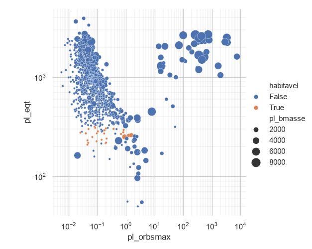

# exoplanets
Análise de dados de exoplanetas disponibilizado pela NASA, durante o período de 1992 a 2026.  

Fonte de dados https://exoplanetarchive.ipac.caltech.edu/cgi-bin/TblView/nph-tblView?app=ExoTbls&config=PS
